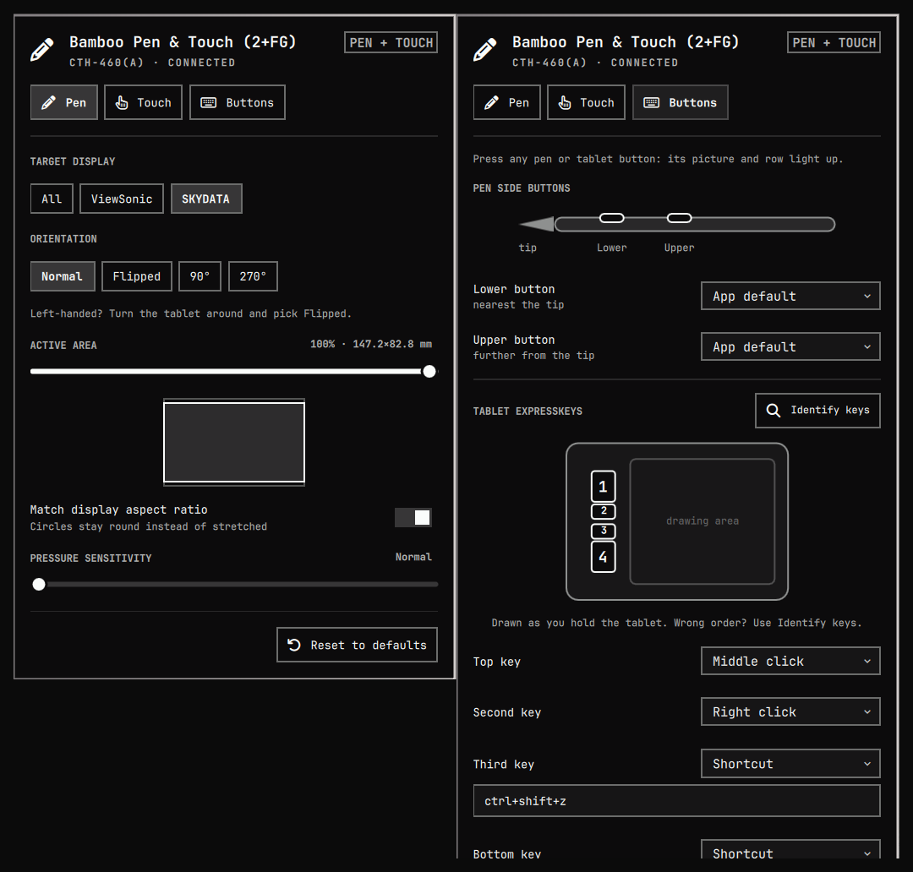
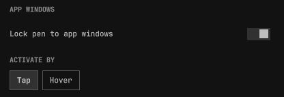
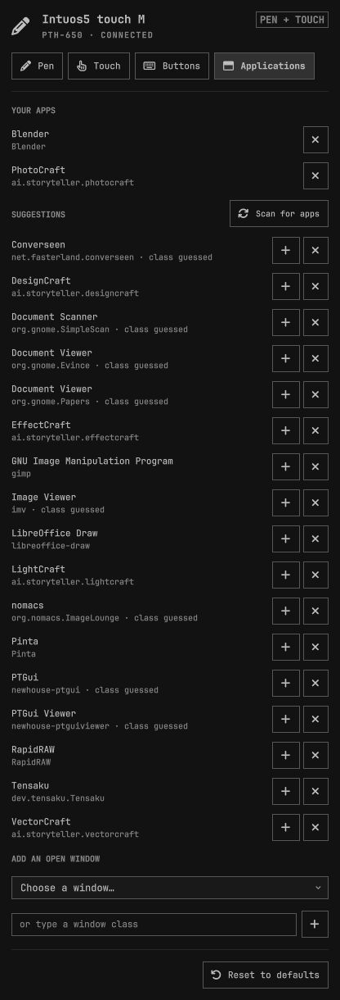
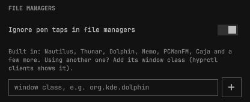

# Wacom Bamboo for Omarchy

A bar widget for the [Omarchy](https://omarchy.org) shell that sets up a Wacom
pen tablet from the bar: which display the pen draws on, orientation
(including flipped for left-handed use), active area, pressure, finger touch,
and what every pen and tablet button does. It can also lock the pen to the
window of the drawing apps you choose, and stop the pen from moving files by
accident in a file manager.



## Features

- **Pen** – target display (any monitor or all of them), active-area size with
  a scale preview, crop to the display's aspect ratio so circles stay round,
  pressure sensitivity.
- **Orientation** – *Flipped* turns the pen, finger touch and the key order
  around for left-handed use (libinput's left-handed mode). 90° and 270° turn
  the pen only.
- **Touch** – finger touch on/off (handy while drawing), pointer speed, tap to
  click, natural scrolling.
- **Buttons** – remap the pen side buttons and the ExpressKeys to a click, a
  keyboard shortcut (`ctrl+z`, `ctrl+shift+s`, `super+w`…), any shell command,
  or nothing, or leave them on **App default** so drawing apps (Krita, Rnote…)
  still get them. Presets cover the usual drawing shortcuts (undo, hold space
  to pan, brush size, eraser, zoom) and commands (toggle finger touch,
  screenshot, colour picker); **Test** runs a command on the spot. The tablet
  is drawn from its real layout; press a physical button and its picture and
  row light up. **Identify keys** relearns the key order if a model's data is
  incomplete.
- **App windows** – lock the pen to the window of chosen apps (PhotoCraft,
  Blender, Krita…): the whole tablet then maps onto that window, in its aspect
  ratio so circles stay round, and the pen can't leave it. Everywhere else the
  pen covers the desktop as before. See [App windows](#app-windows).
- **Applications** – the list of apps for the lock, filled from the drawing
  apps (Graphics category) found on the system, from the windows open now, or
  by typing a window class.
- **File managers** – optionally, the pen tip doesn't click in file managers,
  so a pen that touches down by accident can't pick up and move a folder.
  The mouse and the pen's buttons still work there.
- The panel adapts to the tablet that's plugged in: tabs and buttons it doesn't
  have are hidden, and the bar icon disappears while no tablet is connected.
  Changes apply instantly and survive reboots. Colours and fonts follow the
  current Omarchy theme.

## App windows

Turn on **Lock pen to app windows** in the Pen tab and list your drawing apps
in the **Applications** tab.





- **Scan for apps** lists the installed drawing apps (the Graphics category of
  the app launcher). Add the ones you use, or dismiss the ones you don't want
  to see; dismissed apps can be brought back. **Add an open window** takes the
  window class from a window that is open now, which is the sure way for apps
  whose launcher doesn't name their class. A window class can also be typed in.
  Find it with `hyprctl clients`.
- **Activate by Tap** (the default): the first tap of the pen on a listed app
  only activates it. That tap never paints, selects or clicks; the next ones
  do. **Hover** locks as soon as the pen is over the app, with no click, but
  passing over a listed app on the way somewhere else then locks the pen to it.
- The pen is released when focus moves to another window (super+tab, the
  mouse, closing the app). To leave with the pen alone, set a tablet key or
  pen button to **Pen area lock** in the Buttons tab: it releases the pen, and
  presses it back onto the focused app.
- While the pen is locked, a resized or moved window is followed within half a
  second. While it isn't, nothing is polled.
- The pointer jumps once when the lock engages, from where the pen was on the
  desktop to the same spot on the tablet inside the window. 90° and 270° orientations
  don't lock yet.

### File managers



**Ignore pen taps in file managers** (off by default) drops the pen's tip
click while a file manager has focus. Nautilus, Thunar, Dolphin, Nemo,
PCManFM, Caja, SpaceFM, Krusader, Double Commander, elementary Files and
COSMIC Files are built in; add the window class of any other one in the panel.
It works on its own, with or without the lock.

### Settings in `tablet.json`

All of this is set from the panel; the keys are listed for scripting.

| Key | Meaning |
|---|---|
| `areaLock` | Lock the pen to the windows of the apps below. |
| `areaActivate` | `"tap"` (default) or `"hover"`. |
| `apps` | Window class → `{"mode": "window"}`. Matched without regard to case. |
| `ignoredApps` | Classes the app scan no longer suggests. |
| `ignoreFileManagerTaps` | Drop the pen tip's click in file managers. |
| `fileManagers` | Window classes of file managers beyond the built-in ones. |

## Supported hardware

Any Wacom tablet handled by the kernel `wacom` driver, which splits a tablet
into `… Pen`, `… Finger` and `… Pad` input devices. The model name, touch
support, key codes and key layout come from **libwacom**, already installed on
every Omarchy system as a libinput dependency; the active-area size comes from
the driver.

| Family | Models | Notes |
|---|---|---|
| Bamboo Pen & Touch, Fun, SE | CTH-460/461/661 and (A)/SE variants | **Tested on a CTH-460(A).** 4 keys, touch |
| Bamboo Capture, Create, 16FG | CTH-470/670, CTT-470 | 4 keys, touch |
| Bamboo Touch | CTT-460/460(A) | touch and keys, no pen |
| Bamboo Pen, Connect, One | CTL-460/660/470, CTF-430, CTE-660 | pen only |
| Bamboo Fun / Pen (older) | CTE-450/650, MTE-450 | 4 keys along the top |
| Bamboo Pad | CTH-300/301 | 2 keys, touch |
| Intuos S/M, One by Wacom | CTL/CTH-480/490/680/690, CTL-4100/6100, CTL-471/472/671/672 | Intuos Pen & Touch 1st/2nd gen: run **Identify keys** once, libwacom doesn't record their key order |

Only the CTH-460(A) has been tried on real hardware; the others were checked
against libwacom's data and with virtual devices. Reports are welcome.
Huion, XP-Pen and other brands use different drivers and are not supported.
Touch rings and strips on pads are not handled.

## Requirements

- Omarchy 4.x with the Lua Hyprland config (`~/.config/hypr/hyprland.lua`).
- The kernel `wacom` driver. Check with `lsmod | grep wacom`.
  **OpenTabletDriver blocks it** (`/usr/lib/modprobe.d/99-opentabletdriver.conf`).
  To use this widget instead of OpenTabletDriver:

  ```bash
  systemctl --user disable --now opentabletdriver.service
  sudo sh -c ': > /etc/modprobe.d/99-opentabletdriver.conf'   # override the block
  sudo modprobe wacom                                          # then replug the tablet
  ```

- `python-evdev` for button remapping: `omarchy pkg add python-evdev`.

## Install

```bash
omarchy plugin add https://github.com/mug31/omarchy-tablet.git --enable
```

Open the pencil icon in the bar and press **Finish setup** once. Setup:

1. writes `~/.config/hypr/tablet.lua` and adds `require("hypr.tablet")` to
   `~/.config/hypr/hyprland.lua` (after `require("hypr.input")`);
2. installs and starts the `tablet-buttons` systemd user service.

Updating from 0.1: button mappings are carried over automatically.

## How it works

| Piece | Role |
|---|---|
| `Panel.qml` | The bar icon and panel. Every change is sent to `bin/tablet-ctl`. |
| `bin/tabletlib.py` | Finds the tablet in `/proc/bus/input/devices` and reads its libwacom entry and layout. |
| `bin/tablet-ctl` | Saves settings to `~/.config/omarchy/tablet.json`, generates `~/.config/hypr/tablet.lua`, reloads Hyprland. |
| `bin/tabletarea.py` | Runs inside the `tablet-buttons` service. Follows Hyprland's event socket and, for a listed app, maps the pen onto its window with `region_position` / `region_size`, using the part of the tablet that has the window's aspect ratio; releases it again when focus leaves. Also reads the installed launchers for the app scan. |
| `bin/tablet-buttons` | User service. While any ExpressKey is remapped it grabs the pad and runs the actions through a virtual keyboard and mouse; keys left on App default are replayed through a virtual pad of the same name, so apps still see them. With every key on App default the pad isn't touched. The pen is only grabbed while a side button is remapped, tap activation is on, or taps in file managers are ignored; it is then replayed through a virtual clone (`… Pen Remap`), so pressure and tilt keep working. |

The pen's pressure arrives before its touch in the same frame, so the service
looks at a whole frame before deciding whether to swallow a tap.

`tablet.lua` is generated: change settings from the panel, not by hand. The
app and file-manager settings don't appear in it: only the service reads them.

`python3 -m unittest discover tests` runs the checks for the window and
launcher maths.

`bin/tablet-ctl toggle fingerEnabled` flips finger touch on or off with a
notification, so it can go on a tablet button or a Hyprland keybinding.

## Uninstall

```bash
systemctl --user disable --now tablet-buttons.service
rm ~/.config/systemd/user/tablet-buttons.service
sed -i '/require("hypr.tablet")/d' ~/.config/hypr/hyprland.lua
rm ~/.config/hypr/tablet.lua ~/.config/omarchy/tablet.json
omarchy plugin remove io.github.mug31.wacom-bamboo
```

## License

MIT
